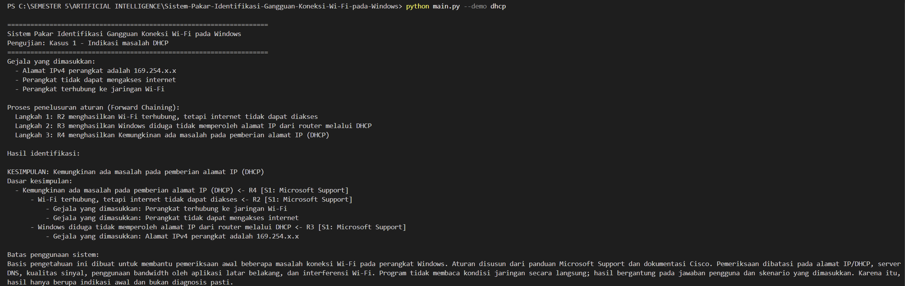
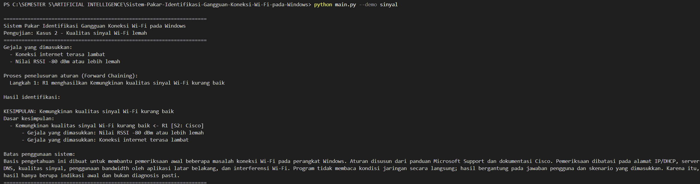
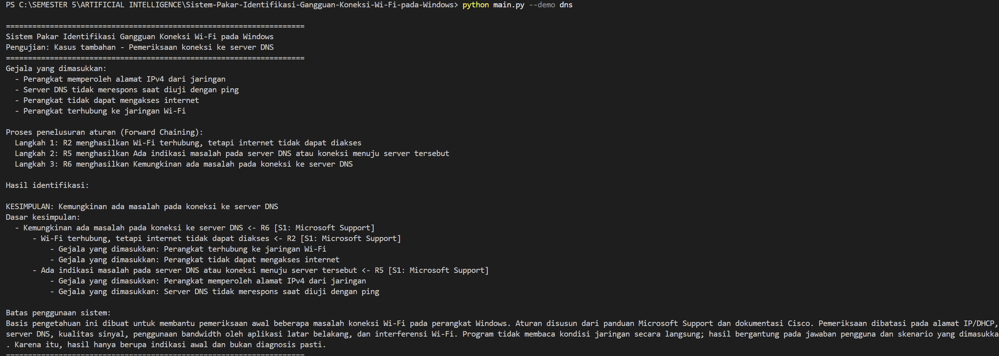
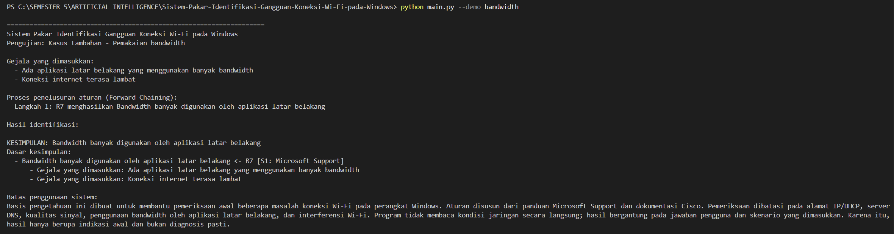
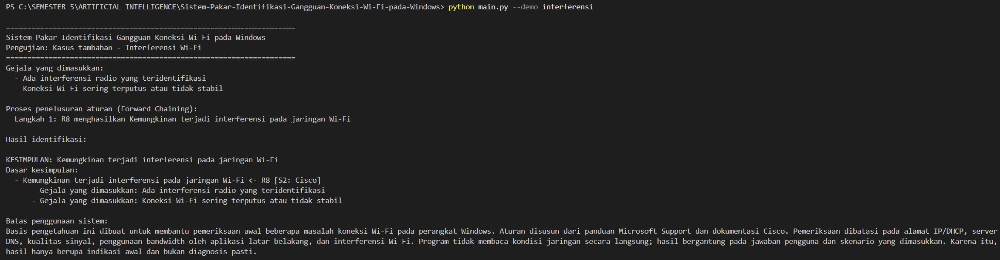
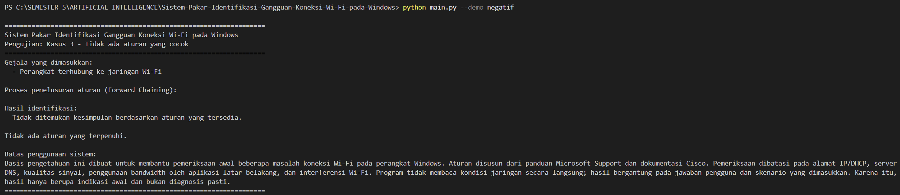

# Sistem Pakar Identifikasi Gangguan Koneksi Wi-Fi pada Windows

> Tugas 5 – Kecerdasan Buatan (MKL1303131), Teknik Informatika, Universitas Mataram.

## Identitas

- **Nama:** Rifdah Asyliyah
- **NIM:** F1D02410090
- **Mata kuliah:** Kecerdasan Buatan
- **Topik:** Sistem Pakar Identifikasi Gangguan Koneksi Wi-Fi pada Windows

## 1. Deskripsi

Proyek ini merupakan sistem pakar sederhana untuk membantu mengidentifikasi kemungkinan penyebab gangguan koneksi Wi-Fi pada perangkat Windows berdasarkan gejala yang dimasukkan pengguna. Sistem menggunakan basis pengetahuan eksternal dalam `kb_wifi.json` dan mesin inferensi Forward Chaining yang diimplementasikan di `main.py`.

Sistem menghasilkan lima jenis kesimpulan:

1. Kemungkinan gangguan kualitas sinyal Wi-Fi.
2. Kemungkinan gangguan pemberian alamat IP (DHCP).
3. Kemungkinan gangguan resolusi/konfigurasi DNS.
4. Kemungkinan bandwidth banyak digunakan aplikasi latar belakang.
5. Kemungkinan interferensi pada jaringan Wi-Fi.

Kesimpulan merupakan indikasi awal, bukan diagnosis teknis yang pasti. Program tidak mengukur kondisi jaringan secara otomatis; fakta diperoleh dari jawaban pengguna atau skenario demonstrasi.

## 2. Struktur proyek

```text
Sistem-Pakar-Identifikasi-Gangguan-Koneksi-Wi-Fi-pada-Windows/
├── main.py
├── kb_wifi.json
├── HASIL_UJI_LOKAL.txt
├── README.md
└── screenshot/
    ├── kasus_1_dhcp.png
    ├── kasus_2_sinyal.png
    ├── kasus_3_dns.png
    ├── kasus_4_bandwidth.png
    ├── kasus_5_interferensi.png
    └── kasus_6_negatif.png
```

## 3. Persyaratan dan cara menjalankan

- Python 3.9 atau lebih baru.
- Tidak memerlukan library eksternal; program menggunakan standard library Python.

Periksa versi Python:

```bash
python --version
```

Jalankan mode interaktif:

```bash
python main.py
```

Jalankan enam skenario pengujian:

```bash
python main.py --demo dhcp
python main.py --demo sinyal
python main.py --demo dns
python main.py --demo bandwidth
python main.py --demo interferensi
python main.py --demo negatif
```

Jika nama file basis pengetahuan berbeda atau berada di lokasi lain:

```bash
python main.py --kb lokasi/kb_wifi.json
```

## 4. Sumber pengetahuan

Sumber pengetahuan berasal dari dokumentasi Microsoft Support, dokumentasi teknis Cisco, dan panduan layanan TI University of Minnesota.

| Kode | Judul | Penerbit | URL |
|---|---|---|---|
| S1 | Memperbaiki masalah koneksi Wi-Fi di Windows | Microsoft Support | https://support.microsoft.com/id-id/windows/experience/connectivity-networking/fix-wi-fi-connection-issues-in-windows |
| S2 | Troubleshooting a Traditional Cisco Wireless Network | Cisco | https://www.cisco.com/c/en/us/support/docs/smb/wireless/CB-Wireless-Mesh/1902-tz-Troubleshooting-Traditional-Cisco-Wireless-Network.html |
| S3 | WiFi: Troubleshoot Your Connection | University of Minnesota IT | https://it.umn.edu/services-technologies/self-help-guides/wifi-troubleshoot-your-connection |

### Ringkasan relevansi sumber

- **S1 (Microsoft):** menjadi rujukan untuk kondisi Wi-Fi terhubung tetapi tidak ada internet, alamat `169.254.x.x` sebagai indikasi Windows tidak memperoleh alamat dari router melalui konfigurasi DHCP otomatis, serta pemeriksaan alamat IP dan server DNS.
- **S2 (Cisco):** menjadi rujukan untuk pengaruh kualitas sinyal dan interferensi radio terhadap performa serta kestabilan WLAN.
- **S3 (University of Minnesota IT):** menjadi rujukan untuk kemungkinan aplikasi latar belakang menggunakan bandwidth dan memperlambat koneksi.

## 5. Basis pengetahuan dan aturan IF-THEN

File `kb_wifi.json` menyimpan daftar sumber, pertanyaan fakta, label fakta, kesimpulan akhir, dan delapan aturan IF-THEN. Setiap aturan mencantumkan kode sumber yang menjadi rujukan.

| Aturan | IF (kondisi) | THEN (hasil) | Jenis | Sumber |
|---|---|---|---|---|
| R1 | RSSI -80 dBm atau lebih lemah DAN internet lambat | Gangguan sinyal Wi-Fi | Kesimpulan | S2 |
| R2 | Wi-Fi terhubung DAN tidak ada internet | Koneksi lokal tanpa internet | Fakta antara | S1 |
| R3 | Alamat IP berada pada rentang 169.254.x.x | Indikasi gagal memperoleh IP melalui DHCP | Fakta antara | S1 |
| R4 | Koneksi lokal tanpa internet DAN indikasi gagal DHCP | Gangguan DHCP | Kesimpulan | S1 |
| R5 | IP valid DAN akses IP berhasil tetapi nama domain gagal | Indikasi masalah DNS | Fakta antara | S1 |
| R6 | Koneksi lokal tanpa internet DAN indikasi masalah DNS | Gangguan DNS | Kesimpulan | S1 |
| R7 | Aplikasi latar belakang menggunakan bandwidth besar DAN internet lambat | Pemakaian bandwidth tinggi | Kesimpulan | S3 |
| R8 | Interferensi radio teridentifikasi DAN koneksi tidak stabil | Kemungkinan interferensi Wi-Fi | Kesimpulan | S2 |

**Aturan berantai:** R2 dan R3 menghasilkan fakta antara. Kedua fakta tersebut menjadi kondisi R4. Dengan demikian, hasil aturan sebelumnya digunakan oleh aturan berikutnya.

Catatan: R1 menggunakan RSSI `-80 dBm` atau lebih lemah sebagai ambang operasional untuk demonstrasi, bukan batas universal untuk semua perangkat atau kondisi jaringan. R5 menghasilkan indikasi masalah DNS, sehingga masih diperlukan pemeriksaan lanjutan untuk memastikan penyebabnya.

## 6. Metode inferensi: Forward Chaining

Forward Chaining dimulai dari fakta/gejala yang diberikan pengguna. Program memeriksa aturan yang kondisinya terpenuhi, menambahkan fakta baru ke memori kerja, lalu mengulangi pemeriksaan sampai tidak ada aturan baru yang dapat dijalankan.

### Langkah algoritma

1. Program membaca basis pengetahuan dari `kb_wifi.json`.
2. Pengguna menjawab pertanyaan gejala dengan `y` (ya) atau `t` (tidak), atau menjalankan skenario demonstrasi.
3. Fakta yang bernilai ya dimasukkan ke memori kerja.
4. Program memeriksa aturan IF-THEN.
5. Jika kondisi aturan terpenuhi dan hasilnya belum ada di memori, hasil aturan ditambahkan.
6. Program mencatat aturan yang menghasilkan fakta tersebut.
7. Proses diulang sampai tidak ada aturan baru yang terpenuhi.
8. Program menampilkan kesimpulan akhir dan alasan penelusuran aturan.

### Pseudocode

```text
memori = fakta_awal
ulangi:
    aturan_baru_ditemukan = false
    untuk setiap aturan:
        jika kondisi aturan terpenuhi
           dan hasil belum ada di memori:
               tambahkan hasil ke memori
               catat aturan sebagai alasan
               aturan_baru_ditemukan = true
    jika tidak ada aturan baru:
        berhenti
tampilkan kesimpulan akhir dan alasan
```

## 7. Pengujian

Enam skenario berikut digunakan untuk memperlihatkan lima kemungkinan kesimpulan dan satu kasus ketika sistem tidak menghasilkan kesimpulan.

### Kasus 1 – Dugaan gangguan DHCP

Fakta awal:

- Perangkat terhubung ke Wi-Fi.
- Tidak ada akses internet.
- Alamat IPv4 berada pada rentang `169.254.x.x`.

Alur aturan: R2 dan R3 menghasilkan fakta antara, kemudian R4 menghasilkan kesimpulan dugaan gangguan DHCP.

Perintah:

```bash
python main.py --demo dhcp
```

Hasil yang diharapkan: **Kemungkinan gangguan pemberian alamat IP (DHCP)**.



### Kasus 2 – Dugaan gangguan kualitas sinyal

Fakta awal:

- RSSI Wi-Fi `-80 dBm` atau lebih lemah.
- Internet terasa lambat.

Alur aturan: R1 menghasilkan dugaan gangguan kualitas sinyal Wi-Fi.

Perintah:

```bash
python main.py --demo sinyal
```

Hasil yang diharapkan: **Kemungkinan gangguan kualitas sinyal Wi-Fi**.



### Kasus 3 – Dugaan masalah DNS

Fakta awal:

- Perangkat terhubung ke Wi-Fi.
- Tidak ada akses internet.
- Alamat IPv4 valid.
- Akses menggunakan alamat IP berhasil, tetapi nama domain gagal diakses.

Alur aturan: R2 menghasilkan fakta koneksi lokal tanpa internet, R5 menghasilkan indikasi masalah DNS, kemudian R6 menghasilkan kesimpulan dugaan gangguan DNS.

Perintah:

```bash
python main.py --demo dns
```

Hasil yang diharapkan: **Kemungkinan gangguan resolusi/konfigurasi DNS**.



### Kasus 4 – Pemakaian bandwidth oleh aplikasi latar belakang

Fakta awal:

- Aplikasi latar belakang menggunakan bandwidth besar.
- Internet terasa lambat.

Alur aturan: R7 menghasilkan dugaan pemakaian bandwidth tinggi oleh aplikasi latar belakang.

Perintah:

```bash
python main.py --demo bandwidth
```

Hasil yang diharapkan: **Kemungkinan bandwidth banyak digunakan aplikasi latar belakang**.



### Kasus 5 – Dugaan interferensi Wi-Fi

Fakta awal:

- Interferensi radio telah teridentifikasi.
- Koneksi Wi-Fi tidak stabil.

Alur aturan: R8 menghasilkan kemungkinan interferensi pada jaringan Wi-Fi. Identifikasi interferensi pada skenario ini merupakan fakta masukan, bukan hasil pengukuran otomatis oleh program.

Perintah:

```bash
python main.py --demo interferensi
```

Hasil yang diharapkan: **Kemungkinan interferensi pada jaringan Wi-Fi**.



### Kasus 6 – Kasus negatif (tidak ditemukan kesimpulan)

Fakta awal:

- Perangkat terhubung ke Wi-Fi.

Tidak ada aturan yang terpenuhi karena fakta yang tersedia belum cukup untuk mendukung kesimpulan mana pun.

Perintah:

```bash
python main.py --demo negatif
```

Hasil yang diharapkan: **Tidak ditemukan kesimpulan berdasarkan aturan yang tersedia**.



## 8. Batas keberlakuan

Sistem hanya mencakup indikasi sinyal lemah, masalah pemberian alamat IP melalui DHCP, indikasi masalah DNS, penggunaan bandwidth oleh aplikasi latar belakang, dan interferensi Wi-Fi. Kesimpulan bergantung pada kebenaran fakta yang dimasukkan pengguna dan aturan yang tersedia. Program tidak melakukan pengukuran jaringan secara otomatis, sehingga hasilnya merupakan saran awal dan bukan diagnosis pasti atau pengganti pemeriksaan administrator jaringan/teknisi.

## 9. Penggunaan alat bantu AI

ChatGPT digunakan sebagai alat bantu untuk memahami ketentuan tugas, menyusun rancangan aturan berdasarkan sumber yang dicantumkan, membantu kerangka program Python Forward Chaining, serta membantu dokumentasi dan skenario pengujian. Sumber, kode, dan hasil pengujian tetap perlu diperiksa dan dipahami oleh pemilik tugas.


**Mata Kuliah:** Kecerdasan Buatan (MKL1303131)  
**Program Studi:** Teknik Informatika, Universitas Mataram